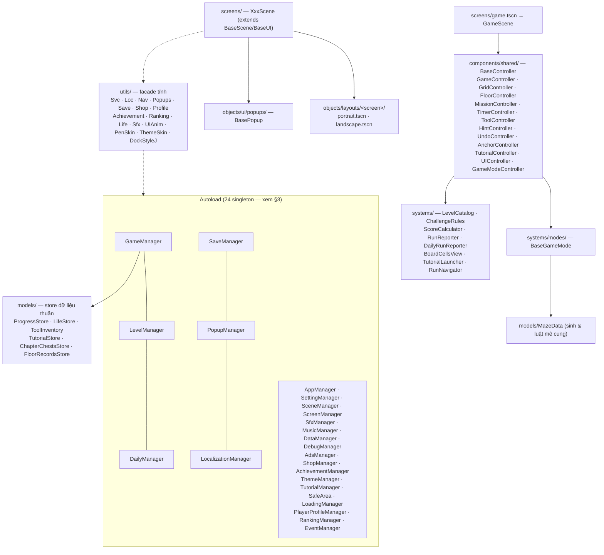

# Kiến trúc InkMaze (Godot 4.8.dev)

> **Nguồn sự thật:** scene / `.tres` giữ **bố cục & giá trị tĩnh** (vị trí, kích thước, text, kết nối signal,
> `@export` bind sẵn); script chỉ giữ **hành vi** (dữ liệu, trạng thái, màu theo dữ liệu runtime).
> `docs/STRUCTURE.md` là bản mô tả **trước** đợt refactor (đường dẫn `nodes/`, `scripts/ui/` đã không còn) —
> dùng file này làm chuẩn.

## 1. Sơ đồ lớp



## 2. Cây thư mục (sau refactor)

| Thư mục | Nội dung |
|---|---|
| `scenes/base/` | `base_scene · base_layout · base_popup · base_hud · base_tutorial` — vỏ dùng chung |
| `scenes/screens/` | 14 màn: `main · splash · title · shop · daily · ranking · achievement · settings · credit · tutorial · tutorial_list · event · game · debug` |
| `scenes/objects/layouts/<màn>/` | `portrait.tscn` · `landscape.tscn` (thường kế thừa `base_layout.tscn`) |
| `scenes/objects/{game,ui,main,daily,shop,…}/` | component: bàn cờ, chip, card, popup, HUD… |
| `scenes/components/{game,main,daily,tutorials}/` | ô/tường/con trỏ… (mảnh nhỏ của bàn cờ & tutorial) |
| `scripts/autoload/` | 24 singleton (xem §3) | 
| `scripts/base/` | `BaseScene · BaseUI · BaseLayout · BasePopup · BaseHUD · BaseTutorial · BaseInteractivePathTutorial` |
| `scripts/screens/` | controller của từng MÀN (`XxxScene.gd`) |
| `scripts/components/shared/` | `BaseController` + 11 controller gameplay + `AnchorController` |
| `scripts/components/{daily,game,hud,main,tutorials}/` | script của component cùng tên trong `scenes/` |
| `scripts/objects/{achievements,daily,game,layouts,level_selection,main,profiler,ranking,shop,tutorials,ui}/` | script của object tương ứng |
| `scripts/systems/` | luật & dịch vụ không phụ thuộc UI: `LevelCatalog · ChallengeRules · ScoreCalculator · RunReporter · DailyRunReporter · BoardCellsView · TutorialLauncher · RunNavigator · ShopCardTap` |
| `scripts/systems/modes/` | `BaseGameMode` và các chế độ chơi (§4) |
| `scripts/systems/services/` | backend lưu: `SaveBackend · LocalSaveBackend · PlayGamesSaveBackend` |
| `scripts/models/` | dữ liệu thuần: `GameState · MazeData · MissionTypes · MissionContext` + 6 store (§5) |
| `scripts/models/definitions/` | `LevelData · ChapterData · AchievementData · AvatarData · FrameData · ProfilerTitleData · BlueprintStep(Drag) · Event*` |
| `scripts/utils/` | facade tĩnh + helper thuần (`PaperGeometry · DebugData · UIAnim · …`) |
| `scripts/constants/` | `ToolIds` (id công cụ dùng chung) |
| `scripts/editor/` | tool chạy trong editor (không chạy runtime) |
| `tests/unit/` | unit test mới (`test_*.gd`, chạy bằng `tests/run_tests.gd`) |
| `tests/legacy/` | 82 test cũ (`legacy_*.gd`, chạy bằng `tools/run_tests.py`) |

**Quy ước:** đường dẫn script = đường dẫn scene đổi `scenes/` → `scripts/` và `.tscn` → `.gd`
(`scenes/objects/ui/popups/won.tscn` ↔ `scripts/objects/ui/popups/WonPopup.gd`, PascalCase).
Mỗi script giữ **cặp** `.gd` + `.gd.uid` — không sửa tay `uid`.

## 3. Autoload (24)

| Tên | File | Vai trò |
|---|---|---|
| `SafeArea` | `scripts/autoload/SafeArea.gd` | vùng an toàn (tai thỏ / notch) |
| `LoadingManager` | `scripts/autoload/LoadingManager.gd` | splash + tiến trình nạp |
| `LevelManager` | `scripts/autoload/LevelManager.gd` | đọc `resources/levels`, chương, thứ tự màn |
| `GameManager` | `scripts/autoload/GameManager.gd` | state toàn cục: Xu, Sao, lượt chơi, kho công cụ, tutorial, Daily, hẹn lưu |
| `AppManager` | `scripts/autoload/AppManager.gd` | vòng đời app, pause/resume, back |
| `SettingManager` | `scripts/autoload/SettingManager.gd` | âm lượng, ngôn ngữ, rung |
| `SceneManager` | `scripts/autoload/SceneManager.gd` | đổi scene + hiệu ứng chuyển cảnh (`SceneTransition`) |
| `ScreenManager` | `scripts/autoload/ScreenManager.gd` | chồng màn/popup trong cùng scene |
| `PopupManager` | `scripts/autoload/PopupManager.gd` | mở/đóng popup theo id (`Popups`) |
| `SfxManager` | `scripts/autoload/SfxManager.gd` | pool âm thanh hiệu ứng (`Sfx`) |
| `MusicManager` | `scripts/autoload/MusicManager.gd` | soundtrack + bus âm lượng |
| `DataManager` | `scripts/autoload/DataManager.gd` | blob `player_progress` (key/value + autosave) |
| `DailyManager` | `scripts/autoload/DailyManager.gd` | nhiệm vụ ngày/tháng, Sao Daily, mốc thưởng |
| `DebugManager` | `scripts/autoload/DebugManager.gd` | cờ debug + Debug Console |
| `AdsManager` | `scripts/autoload/AdsManager.gd` | quảng cáo thưởng (placeholder) |
| `LocalizationManager` | `scripts/autoload/LocalizationManager.gd` | 19 ngôn ngữ, `tr()` runtime |
| `SaveManager` | `scripts/autoload/SaveManager.gd` | gom/merge blob qua backend (§6) |
| `ShopManager` | `scripts/autoload/ShopManager.gd` | ví Xu + danh mục mua |
| `AchievementManager` | `scripts/autoload/AchievementManager.gd` | Sổ tay thành tích, điểm AP |
| `PlayerProfileManager` | `scripts/autoload/PlayerProfileManager.gd` | avatar / viền / danh hiệu |
| `RankingManager` | `scripts/autoload/RankingManager.gd` | bảng xếp hạng cục bộ/đám mây |
| `ThemeManager` | `scripts/autoload/ThemeManager.gd` | skin giấy/mực |
| `TutorialManager` | `scripts/autoload/TutorialManager.gd` | tiến trình học + bài thực hành theo màn |
| `EventManager` | `scripts/autoload/EventManager.gd` | sự kiện theo mùa (Halloween…) |

Trong `project.godot`, 11 autoload khai bằng đường dẫn `res://`, 13 autoload còn lại khai bằng `uid://`
(uid trỏ tới cùng file `.gd`) — cả hai đều là singleton toàn cục.

**Không còn `class_name` cho autoload** (P3.1). Truy cập qua `Svc.xxx()` (trả `Node`) hoặc
`const XScript := preload("res://scripts/autoload/X.gd")` khi cần kiểu tĩnh để gọi `signal.connect(cb)`.

## 4. Chế độ chơi (kế thừa `BaseGameMode` – Resource)

```
BaseGameMode
├── StandardGameMode ──┬── DailyClassicGameMode
│                      └── ChallengeGameMode ──┬── DailyChallengeGameMode
│                                             └── (luật: countdown · step_timer · move_limit …)
├── DungeonGameMode
├── BlindMemoryGameMode
└── WallBuilderGameMode
```

`LevelCatalog.mode_of(LevelData)` quyết định mode của màn (`dungeon`/id lạ ⇒ `play`).
`ChallengeRules` giữ luật theo *thời gian* (`tick`) và theo *nước đi* (`after_step`).

Ván chơi do `GameController` điều phối; mỗi mảng việc nằm trong một controller ở
`scripts/components/shared/` (grid, tầng, nhiệm vụ, đồng hồ, công cụ, gợi ý, undo, neo, tutorial, UI, mode).
`RunReporter`/`DailyRunReporter` chốt kết quả ván; `RunNavigator` điều hướng về nhà/daily/back.

## 5. Store (dữ liệu thuần, không đụng UI)

`ProgressStore` (Sao & thời gian tốt nhất) · `LifeStore` (5 lượt, hồi 30 phút) · `ToolInventory`
(skip/teleport/hint) · `TutorialStore` (bài đã học + luồng onboarding) · `ChapterChestsStore` (3 rương mốc
33%/67%/100%) · `FloorRecordsStore` (kỷ lục Dungeon). `GameManager` chỉ **uỷ thác** và phát signal + hẹn lưu.

## 6. Lưu dữ liệu

`SaveManager` gom blob → `LocalSaveBackend` (DataManager, fallback `user://inkmaze_save.json`) hoặc
`PlayGamesSaveBackend` (Snapshots — khung đã có, còn TODO cho Android).
JSON biến mọi số thành `float`/khoá thành `string` ⇒ mỗi store phải tự ép kiểu trong `load_state()`.

## 7. Bố cục dọc/ngang

`BaseUI` áp responsive (`_apply_responsive_layout`); mỗi màn có 2 layout `.tscn` (`portrait` / `landscape`)
+ script `objects/layouts/<màn>/<Màn>Layout.gd` (biến thể `…Landscape` kế thừa bản dọc).
Node UI do layout khai báo được bind vào script bằng `@export var x: Control` (trong `.tscn` phải có
`node_paths=PackedStringArray("x")` thì engine mới convert `NodePath` → Node).

## 8. Quy ước giữ cho code sạch (đợt refactor P0–P7)

* **`## Scene contract`** ở đầu mỗi script gốc scene/component: `Exports` · `Emits` · `Handlers wired in scene` ·
  `Subscribes in code`. Sinh 1 lần, sau đó sửa tay khi thêm/bớt signal.
* **Signal nối trong `.tscn`** (`[connection …]`) là mặc định. Nối bằng code chỉ khi node sinh lúc chạy và
  phải có tag: `# EXCEPTION(R3-…)` hoặc `# code-connect: runtime|model|tree`.
* **Tag ngoại lệ** dạng `# EXCEPTION(R<n>-<lý do>): <tiêu chí>` đặt **cùng dòng hoặc dòng ngay trên**;
  danh sách tween còn nợ: `docs/refactor/tween_backlog.md`.
* **Không dựng node trong code** (`Node.new()`) trừ node dịch vụ/autoload — mọi thứ khác nằm trong `.tscn`.
* Chạy `python tools/lint_rules.py --max 0` trước khi commit (0 finding mới, 0 ERROR).

## 9. Test

| Bộ | Lệnh | Nội dung |
|---|---|---|
| Unit (mới) | `godot --headless --path . -s res://tests/run_tests.gd` | 87 test cho store/model/system/utils thuần (`tests/unit/**`) |
| Legacy (scene) | `python tools/run_tests.py` | 20 test tích hợp scene (`tests/legacy/legacy_*.gd`), hiện **18/20 PASS** (2 test hỏng sẵn từ baseline) |
| Toàn bộ gate | `python tools/run_checks.py` | lint · scenes · exports · plan · import · load · tests |

`tests/run_tests.gd` chỉ nhặt file `tests/**/test_*.gd`; legacy giữ nguyên tên `legacy_*.gd` nên **không** bị
chạy lẫn. Không sửa `tools/run_checks.py` để thêm G-LEG — hai bộ chạy riêng (xem `docs/refactor/progress.md`).
